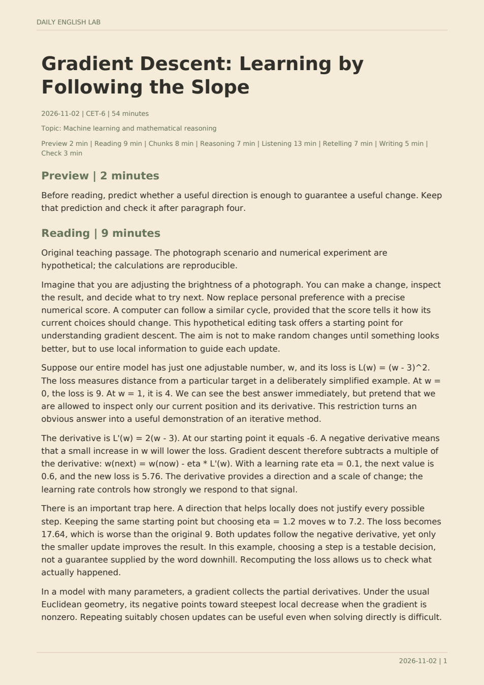

# Daily English Lab · 每日主题英语训练

**用自己喜欢的话题练英语：主讲义纯英文，主题随时可改，支持每日推送。**

这是一个可安装、可分享的 Codex skill。默认六级水平，每天约 54 分钟；也可以改成 20 分钟、30 分钟，或调整难度。主题不限于数学和人工智能，心理学、历史、电影、体育、游戏、音乐、摄影都可以。

[下载 Skill 分享包](https://github.com/ChillyRaiin/-skill/raw/refs/heads/main/downloads/daily-english-lab.zip) · [查看 Skill](skills/daily-english-lab/SKILL.md) · [使用说明](skills/daily-english-lab/使用说明.md)

## 今天的 PDF 长什么样

下面是 **2026-11-02「Gradient Descent」纯英文版**的实际 PDF 首页截图。完整讲义 5 页，包含约 500 词原创教学正文、词块、推理、听力、复述、写作和末尾答案。沿用米黄色纸张背景；可选中文概念提示单独成册。



[打开完整英文 PDF](examples/2026-11-02/English_Lab_2026-11-02.pdf) · [阅读 Markdown 版](examples/2026-11-02/English_Lab_2026-11-02.md) · [可选中文概念提示](examples/2026-11-02/English_Lab_2026-11-02-zh-notes.pdf)

示例为原创教学讲义，数学小算例可复算，不是官方六级真题。事实来源列在讲义末尾；听力部分区分了已核验的作者页面与尚未独立播放的视频。

## 开始使用

1. 下载分享包，解压得到 `daily-english-lab` 文件夹。
2. 放进支持本地 skill 的 Codex 个人目录 `~/.agents/skills/`，或项目的 `.agents/skills/`。保留整个文件夹结构，不只复制 `SKILL.md`。实际安装位置以你当前客户端的 [官方 skill 说明](https://learn.chatgpt.com/docs/build-skills) 为准。
3. 在 Codex 中说：

```text
使用 $daily-english-lab。
我喜欢心理学、历史和摄影，六级水平，每天 30 分钟。
先生成一份让我试试；通过检查后，设置每天晚上 9 点推送，
时区 Asia/Shanghai，返回当前对话。
```

如果只想手动用，去掉最后的推送要求即可。助手会询问尚缺的必要设置，不会默认复制原作者的个人兴趣。

## 主题可以怎样改

不用改代码，直接用自然语言：

| 你说 | 会发生什么 |
| --- | --- |
| 以后改成电影、艺术和城市生活 | 替换长期主题，保留其他设置 |
| 心理学多一点，历史少一点 | 调整相对选题权重 |
| 今天只想读足球 | 只覆盖今天的主题 |
| 不要娱乐八卦 | 加入排除方向 |
| 我每天只有 20 分钟 | 缩短阅读与题量，重新分配时间 |
| 改到晚上 10 点推送 | 更新同一个定时任务 |
| 今天附上中文解析 | 主讲义仍纯英文，中文另附 |
| 暂停推送 | 暂停已创建的任务 |

个人主题、时间、时区和历史保存到你自己的学习目录，不改共享 skill。把原始分享包转给朋友，不会把你的学习记录或推送任务一起带过去。

## 每日训练内容

- **Reading**：PDF 内提供完整原创教学正文，默认 450–650 词。
- **Chunks**：语境词块、英文释义、英文例句。
- **Reasoning**：围绕论证、证据与限制的理解题。
- **Listening**：核验过的材料入口与明确听力任务。
- **Retelling & Writing**：复述支架、短写作、表达自检。
- **Answer key**：放在练习之后，便于先独立作答。
- **Short routes**：15 分钟轻量版与 5 分钟入口，错过的内容不要求补做。

训练指令、释义、图注与答案都用英文。中文提示按需另附。默认周六复盘，也可关闭或改日期；没有实际作答时只做易错点自查，不编造个人成绩。

## 每日推送的条件

**Skill 定义怎样生成训练，定时任务决定何时运行。** 安装分享包不会自动订阅；每位使用者需要在自己的客户端启用任务，并提供时间与时区。

需要客户端具备可用的定时任务、联网检索、文件生成和持久配置能力。缺少定时工具时仍可手动生成。使用本地计划任务时，电脑和应用需要保持运行；云端任务不能假定能读你电脑上的文件，详见 [官方定时任务说明](https://learn.chatgpt.com/docs/automations?surface=app)。

已经存在对应任务时更新它，避免重复推送。每次运行读取最新主题配置，因此“以后换成历史”不需要新建第二个每日任务。

## PDF 字体与验证

附带的生成脚本使用实际嵌入的 TrueType 字体，并重新打开 PDF 核查字体文件和 Unicode 映射。默认英文使用 ReportLab 自带的 Vera；中文附页使用本机合适的 TrueType 中文字体。仓库不分发系统字体。

本次示例已通过：

- 英文主讲义与独立中文附页生成，全部字体资源已嵌入。
- 文字完整性、时间合计、答案位置、主讲义不混入中文的检查。
- PDFium 全页渲染与逐页视觉检查；Poppler 抽查首页。
- 缺失字形、错误时长、提前放答案和覆盖已有文件的失败检查。

脚本检查通过后，助手仍需查看实际页面，不能把“文件生成成功”当成“页面显示正确”。[本次验证记录](docs/validation.json)

## 手动生成 PDF

优先使用客户端已有的 Python 依赖；缺少时安装 `reportlab`、`pypdf`、`pypdfium2`。在学习目录内准备 `lesson.json` 后运行：

```text
python skills/daily-english-lab/scripts/build_lesson.py --input lesson.json --output-dir outputs/2026-11-02
```

也可以用仓库中的完整示例数据复现：

```text
python skills/daily-english-lab/scripts/build_lesson.py --input examples/2026-11-02/lesson.json --output-dir work/example
```

不需要中文附页时，将 `lesson.json` 的 `chinese_notes` 设为 `[]`。生成器默认拒绝覆盖已有输出；重做时换输出目录或指定新的 `--stem`。详细格式见 [讲义数据说明](skills/daily-english-lab/references/lesson-format.md)。

## 文件结构

```text
skills/daily-english-lab/   Skill、主题配置模板、生成脚本与说明
examples/2026-11-02/       今天的英文 PDF、可选中文附页与可复现数据
docs/images/              PDF 实际页面截图
docs/validation.json      本次验证结果
downloads/                可直接分享的 Skill 压缩包
```
